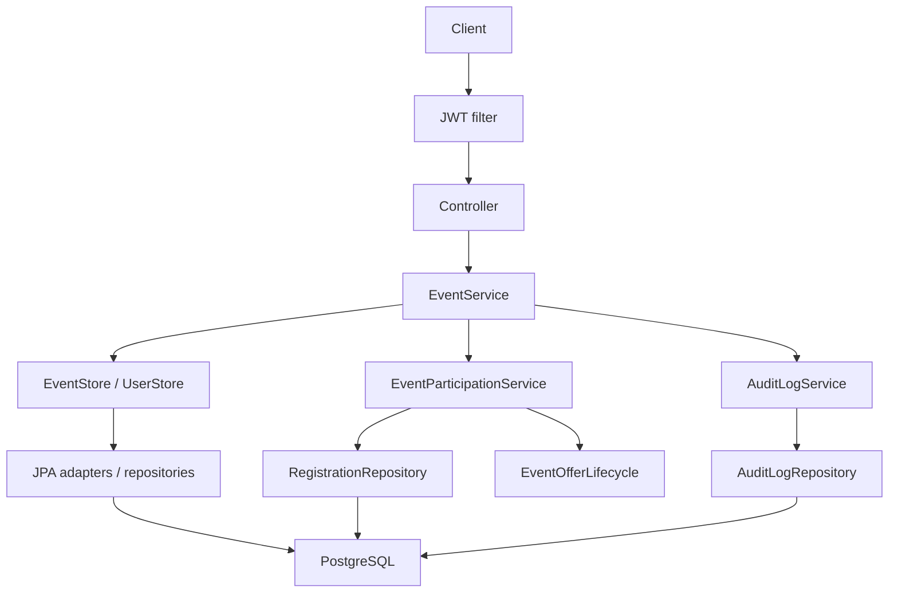

# Kiến trúc backend

Backend là một ứng dụng Spring Boot kết nối PostgreSQL, xử lý nghiệp vụ đồng bộ. Frontend React hỗ trợ
thao tác và demo. Luồng quản lý Event:

## Phân tầng

Controller nhận HTTP/DTO, validate request và lấy principal. EventService kiểm tra quyền, thời gian,
capacity và quản lý transaction. EventStore/PageResult dùng kiểu Java thuần; EventStoreAdapter chuyển
sang Page/Sort và truy vấn JPA. UserStore tra tài khoản. Controller không gọi Repository; Service không
import Spring Web, Spring Data hoặc Hibernate. Entity chứa mapping ORM; JPQL và nhận diện constraint DB
nằm ở Repository.

## Quyền và transaction

organizer_user_id xác định owner từ tài khoản đã xác thực. USER là role duy nhất; quyền quản lý Event
phụ thuộc owner của Event đó. JWT filter xác thực tài khoản, EventService kiểm tra ownership. List/detail
và thumbnail là public; participants và audit yêu cầu owner.

Các thao tác sửa Event, đăng ký và hủy dùng chung PESSIMISTIC_WRITE trên Event. Sau khi lấy khóa, service đọc
Clock và kiểm tra lại dữ liệu để tránh ghi đè counter hoặc tái xác nhận cùng một hàng CANCELLED.
DB CHECK giữ counter không âm và registeredCount + heldCount <= capacity. Unique(user,event) giữ một
registration hiện hành. REMOVED lưu thời điểm, người và lý do loại; trạng thái này không được tự đăng ký lại.

Event mutation, participant change và audit cùng transaction. AuditLogService dùng MANDATORY để ghi audit
trong transaction của thao tác. details lưu dữ liệu trước/sau và đối tượng bị loại; reason lưu lý do.

Thumbnail được lưu trên filesystem. Callback sau commit xóa ảnh cũ, sau rollback xóa ảnh mới; lỗi I/O dọn
file viết dở. Nếu tiến trình dừng trước callback, có thể còn file không được tham chiếu vì filesystem
không thuộc transaction PostgreSQL.

## Thời gian

Một Clock Asia/Ho_Chi_Minh được tiêm cho Event/Registration. Event datetime lưu TIMESTAMP theo giờ Việt Nam;
audit V5 dùng TIMESTAMPTZ/Instant. Cancellation truyền thời điểm từ Clock vào JPQL. Tại đúng startTime,
đăng ký/remove/reopen bị từ chối. Request chờ khóa qua mốc giờ phải kiểm tra lại sau khóa.
TTL là khoảng thời gian cấu hình cho offer mới; thay TTL không sửa deadline đã cấp.

## Tích hợp Waitlist

EventParticipationService đọc Registration và xử lý owner removal. EventOfferLifecycle là contract cho
module Waitlist tham gia các transaction tăng capacity, đóng/mở/xóa và giải phóng chỗ. Provider xử lý
các hook allocate/close/delete trong transaction caller.

Main chưa có module Waitlist/SlotOffer nên hiện không có offer. Nếu heldCount > 0 mà thiếu provider,
thao tác cần xử lý offer bị từ chối; sửa metadata không tác động offer vẫn được phép. Contract test dùng
provider giả lập để kiểm tra hook và rollback. FIFO, accept/decline, scheduler và expiry được kiểm thử
cùng module Waitlist khi tích hợp.

## Migration và baseline

V1–V6 giữ nguyên từ GitHub, gồm V5 Audit/V6 USER role. V11 bổ sung owner/counter/TTL và REMOVED.
V7–V10 thuộc nhánh Waitlist. Event cũ giữ owner NULL cho đến khi có mapping đã xác minh.
DB từng chạy migration thử nghiệm khác cần được sao lưu và có phương án chuyển đổi riêng; không sửa
migration đã chạy hoặc repair để bỏ qua checksum. Xem hướng dẫn chạy và dữ liệu cũ trong README.

Khóa và constraint giữ tính đúng đắn. Đọc audit có thể phát sinh nhiều truy vấn; Event có nhiều yêu cầu
đồng thời có thể chờ khóa. Đây là các đặc điểm cần đo ở baseline; bản này chưa có kết quả kiểm thử tải
Kaggle. Các cải tiến hiệu năng/kiến trúc Pha 2 cần so sánh trên cùng cấu hình phần cứng.
